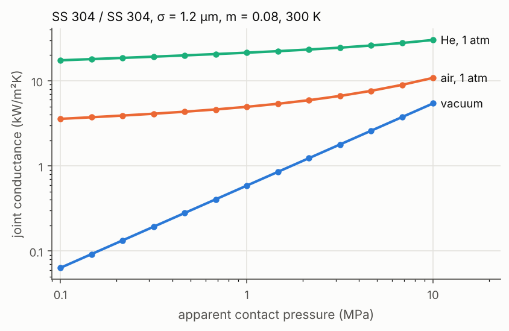
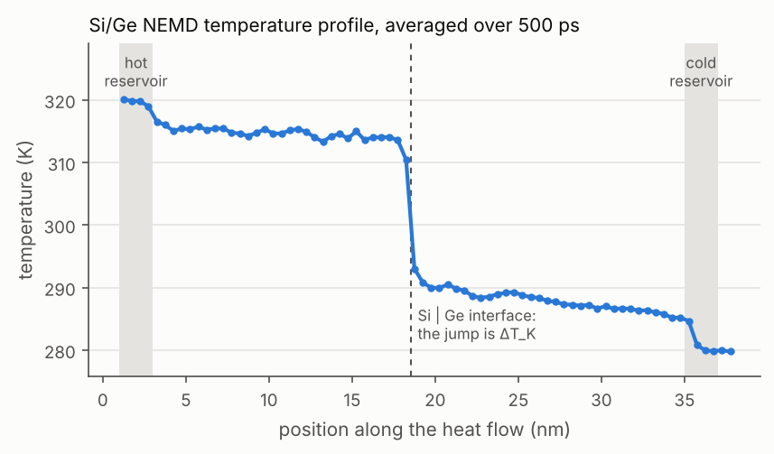
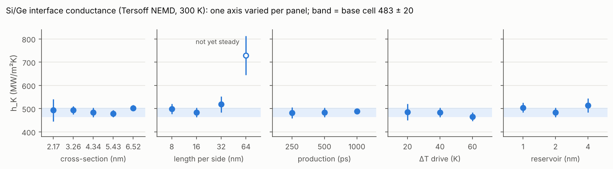
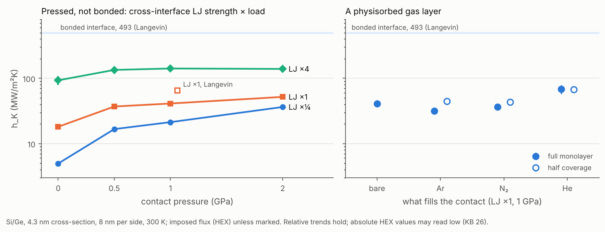

# OpenKapitza — multiscale thermal contact resistance

Total thermal resistance between two solids in contact, for PCB, package and
die-level joints. Three scales, combined on a consistent area basis:

- **contact spots** — Cooper–Mikic–Yovanovich (plastic) or Mikic (elastic)
  constriction from measured roughness, slope and microhardness, with
  light-load truncation, unloading hysteresis and out-of-flatness;
- **gas gap** — conduction through the interstitial gas, with rarefaction and
  sourced accommodation-coefficient bands (skipped in vacuum);
- **the atomic interface** (Kapitza) — a DMM placeholder, replaced by a
  non-equilibrium MD result from LAMMPS when that would change the answer.

Filled and bonded joints (grease, pads, solder, sinter, die attach) go through
a series stack instead. Every number carries its uncertainty and provenance,
and every caveat a stable flag code.

## Quick start

```bash
pip install -e .                          # Python >= 3.9; needs pyyaml, numpy
python -m openkapitza.agent               # guided: asks for the joint, explains the answer
```

Or describe the joint to Claude (or any MCP client) in your own words; the
model fills in the inputs and OpenKapitza does every calculation and check:

```bash
pip install -e ".[mcp]"
claude mcp add openkapitza -- python -m openkapitza.agent.mcp_server
```

From a description file, or in Python:

```bash
python -m openkapitza.agent --input examples/agent/heatsink_screwed.yaml
python -m openkapitza.agent --input joint.yaml --json result.json --sweep pressure_MPa=0.1:5:8:log
```

```python
from openkapitza import build_joint, run_continuum, render

joint = build_joint("SS304", "SS304", sigma_a_um=1.2, sigma_b_um=1.2,
                    slope_a=0.08, slope_b=0.08, pressure_MPa=2.0,
                    temperature_K=300.0, gas="air", gas_pressure_kPa=101.325)
print(render(run_continuum(joint)))
```

The agent answers with the conductance and its band, where the resistance
sits, whether an atomistic calculation would change the answer (and whether
this package has an MD route for the pair), ranked caveats, and the most useful next
measurement. **Start with [`docs/agent-guide.md`](docs/agent-guide.md).**

## Examples

### A bolted steel joint: where the heat goes

The same stainless-steel pair (σ = 1.2 µm, slope 0.08) in vacuum, air and
helium, against contact pressure (`build_joint` + `run_continuum`, the call
shown above):

<picture><source media="(prefers-color-scheme: dark)" srcset="docs/figures/joint_pressure-dark.png"></picture>

In vacuum all heat crosses at the contact spots, so h rises almost linearly
with load (CMY); in air the gas gap carries most of it at low load, and in
helium (~6× air's conductivity) more. On 570 measured points the contact
model lands within RMS 13–15 % (validation table below).

### The atomic interface: an MD measurement

At each contact spot the interface itself resists heat (Kapitza). OpenKapitza
writes, runs and measures LAMMPS non-equilibrium MD for it: heat flows from a
hot to a cold reservoir and the jump at the interface gives h_K = q / ΔT_K.

<picture><source media="(prefers-color-scheme: dark)" srcset="docs/figures/nemd_profile-dark.png"></picture>

Before a number is trusted the cell is varied one axis at a time (Si/Ge,
Tersoff; 14 runs on an M3 Pro laptop through the agent's job loop):

<picture><source media="(prefers-color-scheme: dark)" srcset="docs/figures/sige_convergence-dark.png"></picture>

Four axes agree with the base cell: **483 ± 20 MW/m²K at 16 nm per side**.
Length does not: h rises beyond 16 nm (more long-wavelength phonons), and
the 64 nm cell (hollow) was not yet steady and is being re-run. Hence a
convergence verdict per axis, not a single run ([KB §17](docs/knowledge-base.md)).

### What the interface is made of matters more than anything else

Real contact spots are rarely clean, bonded crystal. The same Si/Ge contact
with the bond removed (van der Waals only), at three bond strengths and four
loads, and with a physisorbed gas layer in the contact (20 NEMD runs):

<picture><source media="(prefers-color-scheme: dark)" srcset="docs/figures/interface_types-dark.png"></picture>

- Losing the bond costs 3.5–100×, depending on how strong the van der Waals
  attraction is and how hard the contact is pressed.
- Load matters most for weak contacts (×7 from 0 to 2 GPa at LJ ×¼); strong
  ones saturate by 0.5 GPa.
- A full Ar or N₂ monolayer costs 10–25 %; half a layer costs nothing
  measurable. He reads *higher* than the bare contact, which is not yet
  explained.
- The absolute level is not settled: at LJ ×1, 1 GPa the Langevin drive
  reads 1.6× the imposed flux (hollow square). An arbitration with the
  direct interfacial heat-flow tally is next ([KB §26](docs/knowledge-base.md)).

Figures: `python3 scripts/make_readme_figures.py`.

## What the models cover

| situation | how | `build_joint` option |
|---|---|---|
| bare metal/semiconductor contact | CMY plastic or Mikic elastic, chosen by plasticity index (both if ambiguous); Song–Yovanovich contact hardness | default |
| gas in the gaps | lumped gap model, rarefaction, accommodation band | `gas=`, `gas_pressure_kPa=` |
| light loads | truncated-Gaussian model (Milanez et al. 2004) | `z_trunc=` |
| crowned / warped faces, bolted joints | macro constriction (Bahrami 2004), clamping check | `flatness_um=`, `joint_area_mm2=`, `clamping=` |
| relaxed or re-tightened joint | Mikic unloading curve | `max_pressure_MPa=` |
| your own indentation data | replaces database hardness | `Hv_a_GPa=`, `c1_a_GPa=`, `c2_a=` (and `_b`) |
| grease, pad, PCM | BLT/k + boundary resistances, class-range check | `fill=tim_fill(...)` |
| solder, sinter, die attach | layered stack + Kapitza faces, voids | `fill=bond_fill(...)` |
| measured or MD interface conductance | replaces the DMM placeholder | `run_continuum(kapitza=...)`; agent `ingest` |

## Equations

What the code evaluates, in the order the pipeline uses it. Each module's
docstring carries the full form, its fitted range and its source.

**Surfaces and materials**

```math
\sigma = \sqrt{\sigma_a^2+\sigma_b^2},\qquad
m = \sqrt{m_a^2+m_b^2},\qquad
k_s = \frac{2k_ak_b}{k_a+k_b},\qquad
\frac{1}{E'} = \frac{1-\nu_a^2}{E_a}+\frac{1-\nu_b^2}{E_b}
```

**Contact microhardness** (Song–Yovanovich, from the softer side's Vickers
coefficients $c_1$, $c_2$, with $\sigma/m$ in µm):

```math
\frac{P}{H_c} = \left[\frac{P}{c_1\,(1.62\,\sigma/m)^{c_2}}\right]^{1/(1+0.071\,c_2)}
```

**Deformation regime**: plasticity index $\psi = E'm/H_c$; plastic for
$\psi \ge 3$, elastic for $\psi \le 0.33$, both branches reported in between.

**Contact-spot conductance**, per apparent area, with the real-area fraction
$\xi = A_r/A_a$:

```math
\text{plastic (CMY):}\quad h_c = 1.25\,k_s\,\frac{m}{\sigma}\left(\frac{P}{H_c}\right)^{0.95},\qquad \xi = \frac{P}{H_c}
```

```math
\text{elastic (Mikic):}\quad h_c = 1.55\,k_s\,\frac{m}{\sigma}\left(\frac{\sqrt{2}\,P}{m E'}\right)^{0.94},\qquad \xi = \frac{\sqrt{2}\,P}{m E'}
```

At light load the truncated-Gaussian form (Milanez et al. 2004) replaces
$P/H_c$ and the separation below.

**Gas gap** (lumped model, with the Yovanovich mean-plane separation):

```math
h_g = \frac{k_g}{Y+M},\qquad Y = 1.53\,\sigma\left(\frac{P}{H_c}\right)^{-0.097},\qquad
M = \left(\frac{2-a_1}{a_1}+\frac{2-a_2}{a_2}\right)\frac{2\gamma}{(\gamma+1)\,Pr}\,\Lambda,\qquad
\Lambda = \frac{\mu}{p}\sqrt{\frac{\pi R T}{2}}
```

$a_{1,2}$ are the thermal accommodation coefficients (sourced bands, or a
short MD gas–surface scattering run); $h_g = 0$ in vacuum.

**Out-of-flatness** (Bahrami 2004, crowned or warped faces): a macro
constriction in series with the asperity one,

```math
R_L = \frac{(1-a_L/b_L)^{1.5}}{2\,k_s\,a_L}
```

with $a_L$ the macro-contact radius from the load, crown and roughness, and
$b_L$ the joint radius.

**The atomic interface** (Kapitza conductance $h_K$, per real contact area).
Placeholder, Debye diffuse mismatch with the elastic cutoff:

```math
h_K^{\text{DMM}} = \frac{k_B}{8\pi^2}\left(\frac{k_BT}{\hbar}\right)^{3} S_{2,1}\,I(x_c)\,\alpha_{12},\qquad
\alpha_{12} = \frac{S_{2,2}}{S_{2,1}+S_{2,2}},\qquad
S_2 = \frac{1}{v_L^2}+\frac{2}{v_T^2},\qquad
I(x) = \int_0^{x}\frac{u^4e^u}{(e^u-1)^2}\,du
```

Replaced by non-equilibrium MD when it matters. The heat flux $q$ comes
from the reservoirs' energy (Langevin tallies, or imposed exactly for
resistive interfaces), and $\Delta T_K$ is the jump between linear fits of
the two bulk profiles, extrapolated to the interface plane:

```math
h_K = \frac{q}{\Delta T_K},\qquad q = \frac{|\Delta E_\text{hot}|+|\Delta E_\text{cold}|}{2\,A\,t}
```

Equilibrium cross-check: the slab temperature difference relaxes with time
$\tau$, so

```math
h_K^{\text{EMD}} = \frac{C_r}{A\,\tau},\qquad C_r = \frac{C_aC_b}{C_a+C_b},\qquad C = 3Nk_B
```

On a metal side, electron–phonon coupling ($g$; lattice conductivity $k_p$)
adds a resistance in series (Majumdar–Reddy), or is resolved directly by
two-temperature MD:

```math
\frac{1}{h_K} = \frac{1}{h_{pp}}+\frac{1}{h_{ep}},\qquad h_{ep} = \sqrt{g\,k_p}
```

The MD is run at the stress inside a contact spot, $\approx H_c$ (GPa), not
at the apparent pressure $P$ (MPa).

**Combining the paths**, all per apparent area. $h_K$ is per real area, so
it enters scaled by $\xi$; omitting that factor understates the Kapitza term
by $10^2$–$10^3$:

```math
R_\text{solid} = \frac{1}{h_c}+\frac{1}{\xi\,h_K}\;(+R_L),\qquad
h_\text{joint} = \frac{1}{R_\text{solid}}+h_g
```

**Filled and bonded joints** (grease, pad, PCM, solder, sinter) go through a
series stack instead, each layer of thickness $t_i$ and conductivity $k_i$,
with boundary resistances at the faces:

```math
R = R_{c,1}+\sum_i \frac{t_i}{k_i}+R_{c,2}
```

## How well it is validated

| test | data | result |
|---|---|---|
| conforming contacts, vacuum | 207 points, Ni 200 / SS 304 (Hegazy, via Bahrami 2004) | geometric mean pred/meas 1.03, RMS 12.7 %, all within 2× |
| more conforming contacts | 158 points incl. Al 6061-T6 and Al/Ni (Antonetti, Milanez, McWaid, Nho) | 0.95, RMS 13.3 %; Al pairs 0.95, 11.1 % |
| crowned contacts | 205 points, steels, brass, Al 2024, Mg, Ni (Bahrami 2004) | with flatness 1.03, RMS 15.3 %; ignoring flatness h ~7× too high |
| light loads | Milanez S1 | RMS 20.8 → 15.5 % with the truncated model (paper: 25.3 → 16.1) |
| grease TIMs | 5 greases, ASTM D5470 (NREL 2017) | stack form reproduces each within 5 % |
| Al/Si interface | 8 TDTR values (Hopkins et al. 2010) | DMM placeholder 1.66× the best interface: an upper estimate |

Not yet validated: the gas path against exact measurements (only digitised
data), Cu or Al joints **in air**, the elastic branch, unloading magnitudes,
and MD interface conductances against experiment (Si/Ge is converged in
cross-section, duration, drive and reservoir, not yet in length; the metal
pairs need a GPU or cluster). Evidence and provenance:
[`tests/benchmarks/SOURCES.md`](tests/benchmarks/SOURCES.md).

## Atomistic side (MD)

LAMMPS non-equilibrium MD with a convergence campaign (cross-section, length,
duration, flux, reservoir), an equilibrium cross-check, two-temperature runs
for electron–phonon resistance on metal sides, spot-pressure loading, and a
structure module for crystalline and amorphous (melt-quench) interfaces.
Routes today: Si/Al and Si/Cu (Jelinek MEAM, passes the elastic gate), Si/Ge
(Tersoff, fails the gate and is reported with that stated), Si/SiO₂ (Tersoff +
melt-quenched a-SiO₂), plus non-bonded and gas-layer contacts
(`structure/nonbonded.py`) and an imposed-flux mode for resistive interfaces.
Si/Ge is converged on every axis but length (above); none is validated
against experiment yet. Long runs checkpoint and resume after a crash. `scripts/prepare_cluster.py`
writes every job, validated and costed (22 jobs, ~70 node-hours);
[`docs/cluster-runbook.md`](docs/cluster-runbook.md) says what to run in what
order; `scripts/benchmark_local.py` times your own machine on the same decks
and says which jobs fit it. The agent submits them (`submit plan`, on SLURM or locally), polls,
retries what the cluster broke (timeouts, node failures), diagnoses input and
physics failures with knowledge-base citations without "fixing" them, and
measures finished runs into the joint automatically.

## Documentation

| file | what it is |
|---|---|
| [`docs/agent-guide.md`](docs/agent-guide.md) | using the agent: conversation, files, sweeps, the MD loop, `lookup`, reading the answer |
| [`docs/open-issues.md`](docs/open-issues.md) | every open item, what closes it, the cluster run list |
| [`docs/knowledge-base.md`](docs/knowledge-base.md) | every defect hit, in Symptom / Cause / Fix / Verify form; literature surveys (§7–§12) |
| [`docs/technical-notes.md`](docs/technical-notes.md) | what Phase 0 corrected in the original spec, design rules, verification history, Phase 1–2 development notes |
| [`docs/agent-instruction-v2.md`](docs/agent-instruction-v2.md) | the specification; read it before changing any correlation, threshold or default |
| [`docs/cluster-runbook.md`](docs/cluster-runbook.md) | cluster procedure |
| [`docs/lammps-rag.md`](docs/lammps-rag.md) | official LAMMPS reference for the physics paths used (generated) |
| [`docs/papers.yaml`](docs/papers.yaml) | our notes on each paper: what it is used for, findings, what is still needed |
| [`tests/benchmarks/SOURCES.md`](tests/benchmarks/SOURCES.md) | provenance of every benchmark number |

## Layout

```
openkapitza/
  agent/      guided use: fields, intake, planner, explain, session, ingest, io, sweep
  rag/        cited keyword search over our docs, paper notes and the LAMMPS manual
  builder.py  the input boundary (build_joint, tim_fill, bond_fill)
  pipeline.py run_continuum: hardness, regime, contact, gap, Kapitza, network
  contact/    hardness, regime, CMY + Mikic, truncated, unloading, macro
  gap/        gas properties, rarefaction, accommodation
  network/    area-scaled series/parallel combination, stacks, Monte Carlo
  md/         DMM, NEMD decks and measurement, campaign, EMD, TTM, elastic, accommodation
  structure/  crystalline and amorphous interface builders, structure analysis
  compute/    local + SLURM job runners, cost model
  schema/     units, Quantity, flags, inputs, data loaders
  data/       materials.yaml, gases.yaml (per-field sources)
scripts/      cluster preparation, structure builders, audits, benchmark builders
examples/     agent sessions and description files
tests/        unit, physics and benchmark tests; benchmarks/ and data/ fixtures
```

```bash
python3 -m unittest discover -s tests      # ~735 tests, ~40 s
```

## Status

Phases 0–2 built. Phase 3 (agent) built: guided input, planning, files and
sweeps, cited lookup, the MD job loop (submit, poll, diagnose, retry, ingest),
and an MCP server; MD runs on a laptop (queued, checkpointed). Under way: the
interface-type sweep, the Si/Ge length axis and the scenario list in
[`docs/open-issues.md`](docs/open-issues.md); then Phase 4 ML potentials.
